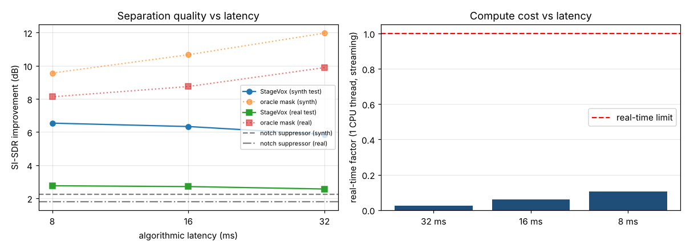
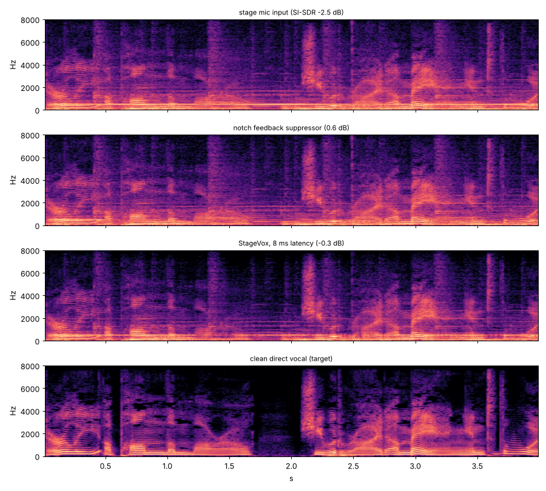

# StageVox: ultra-low-latency vocal isolation for live stage mics

StageVox takes the signal from a singer's microphone on stage and returns the clean
vocal **in real time, with 8 ms of algorithmic latency**. It removes the three things a
live vocal mic picks up besides the voice:

- **Bleed** from the band (drums, bass, keys, guitar, PA spill), arriving late, off-axis and reverberant.
- **Acoustic feedback**: the monitor wedge re-enters the mic. Below the howl threshold this rings on every note; above it, it builds into a sustained howl.
- **Other unwanted components**: stage noise and mains hum.

The project has three parts:

1. A **simulator** that builds live-stage scenes with a known clean target.
2. A **causal streaming separator** in PyTorch.
3. A **latency / compute / quality trade-off study** comparing the separator against an oracle mask and a classic console-style feedback suppressor.



## Why a simulator

A real stage recording never comes with the isolated vocal, so it can't be scored. StageVox builds each scene from separate stems and passes them through the same
signal chain a stage applies. That gives perfect ground truth, plus control over each effect:

| Stage | What is modelled | Code |
|---|---|---|
| Vocal at the mic | Proximity-effect low shelf and capsule presence peak (these are part of the target) | `scenes.make_scene` |
| Band stems | Channel strip on every stem: random HPF and bell/shelf EQ (RBJ biquads), then a feed-forward compressor with attack and release | `fx.eq`, `fx.compressor` |
| Bleed | Each stem is delayed by its distance (1.5–6 m), loses highs off-axis, picks up room reverb (synthetic RIR with early reflections and an RT60 tail), and is mixed at a vocal-to-bleed ratio of −6 to +12 dB | `scenes.bleed_from` |
| Feedback loop | Mic → monitor amp (soft saturation) → wedge response → 1–3.5 m path and room → mic, simulated as a true closed loop. The path is normalised so that g = 1 is the onset of howl. g is drawn from 0.90–1.30: below 1 it rings, above 1 it howls at the amp's limit | `scenes.acoustic_feedback` |
| Noise | Pink stage noise, and 50/60 Hz mains hum with harmonics | `fx.pink_noise`, `fx.mains_hum` |

Sources for the stems:

- **Vocals:** a source-filter singing synthesiser (scooped onsets, vibrato, jitter, vowel-formant morphing, consonant bursts) and real read speech from 58 VCTK training speakers.
- **Band:** procedural drums, bass, keys and Karplus-Strong guitar, plus excerpts of three real instrumental recordings.

## Model

`stagevox/model.py` is a causal STFT model with deep filtering:

- **Framing:** sqrt-Hann window of W samples, hop W/2, perfect reconstruction.
- **Network:** linear embedding, then a causal conv, then a 2-layer uni-directional GRU (hidden size 128).
- **Output:** per bin, **3 complex filter taps over the current and two previous frames** ("deep filtering", as in DeepFilterNet). A magnitude mask can only turn bins down. Complex taps across frames can also undo short convolutive paths, which is exactly what the monitor-to-mic feedback loop is.
- **Loss:** negative SI-SDR on the time-domain output.

The algorithmic latency is the window length, so W = 128 at 16 kHz gives 8 ms. The network looks at no future frames. Two tests enforce this:

- `test_no_lookahead_beyond_window`: changing input after sample k cannot change any output before k − W + 1.
- `test_streaming_matches_offline`: the frame-by-frame `StreamingSeparator`, which holds GRU state, a conv buffer, frame history and an overlap-add buffer, matches the offline model to 1e-5.

## Results

All numbers are **SI-SDR improvement (dB)** over the unprocessed mic signal. They come from `results/results.json`, produced by `scripts/evaluate.py`. There are two test sets:

- **Synthetic test:** 180 scenes, 60 of each type, generated from seeds never used in training. Mean input SI-SDR is 2.1 dB.
- **Real held-out test:** 54 scenes. The vocal is real read speech from 3 LibriSpeech speakers who were never seen in training. The bleed is from 3 real music recordings that were also never seen. Mean input SI-SDR is 2.5 dB.

### Quality vs latency

| Method | Latency (ms) | Synthetic test | Real held-out test |
|---|---|---|---|
| Notch feedback suppressor (DSP baseline) | 0 (IIR) | +2.23 | +1.80 |
| StageVox, W = 512 | 32 | +5.86 | +2.56 |
| StageVox, W = 256 | 16 | +6.33 | +2.71 |
| StageVox, W = 128 | 8 | +6.54 | +2.76 |
| *Oracle magnitude mask, W = 512 (masking ceiling)* | 32 | *+11.97* | *+9.89* |
| *Oracle magnitude mask, W = 256 (masking ceiling)* | 16 | *+10.67* | *+8.75* |
| *Oracle magnitude mask, W = 128 (masking ceiling)* | 8 | *+9.56* | *+8.13* |

### Where the gains come from (8 ms model)

| Scene type | Notch, synthetic | StageVox 8 ms, synthetic | Notch, real | StageVox 8 ms, real |
|---|---|---|---|---|
| bleed | -0.53 | +6.63 | +0.01 | +1.55 |
| feedback | +5.75 | +5.82 | +4.60 | +4.65 |
| bleed+feedback | +1.47 | +7.16 | +0.79 | +2.06 |

### Compute (streaming, one CPU thread, frame by frame through `StreamingSeparator`)

| Window | Latency | Params | Compute (MMAC/s) | Per-hop time p50 / p99 (ms) | Hop (ms) | Real-time factor | Deadline misses |
|---|---|---|---|---|---|---|---|
| 512 | 32 ms | 480k | 30 | 0.41 / 0.59 | 16 | 0.025 | 0.0% |
| 256 | 16 ms | 364k | 45 | 0.47 / 0.68 | 8 | 0.060 | 0.0% |
| 128 | 8 ms | 306k | 76 | 0.42 / 0.65 | 4 | 0.104 | 0.0% |

### What the numbers say

- **8 ms is the best setting here, not a compromise.** Shorter windows lower the oracle ceiling (+11.97 → +9.56 dB, synthetic) because frequency resolution drops. But the trained model is far below that ceiling, and it improved slightly as the window shrank. The gain came almost entirely on feedback (+4.03 → +5.82 dB synthetic, +3.24 → +4.65 dB real). Shorter hops give the 3-tap deep filter finer time steps on the feedback path. Bleed goes the other way: on real bleed, 32 ms beats 8 ms (+2.25 vs +1.55 dB).
- **Compute grows with frame rate, not window size.** Going from 32 ms to 8 ms cuts per-frame work but quadruples frames per second, so the real-time factor rises from 0.025 to 0.104. That still leaves about 10x headroom on a single thread, with a worst-case (p99) of 0.65 ms per 4 ms hop and no missed deadlines.
- **The classic notch suppressor is hard to beat on pure howl, and useless on bleed.** On real pure-feedback scenes it matches the network (+4.60 vs +4.65 dB) at zero latency. On bleed it does nothing (+0.01 dB). When both problems are present, the network wins (+2.06 vs +0.79 dB).
- **Domain gap (the honest caveat).** On real audio the network gains +2.76 dB, compared with +6.54 dB on synthetic scenes. The oracle at the same latency reaches +8.13 dB on the real set. Most training material was synthetic: the band is procedural, and half the vocals are synthesised. The real-speech test vocals are speech, not singing. Closing this gap with real multitrack data is the obvious next step.



*A typical real held-out bleed+feedback scene, chosen as the one closest to the mean score rather than the best. Top to bottom: mic input, notch suppressor, StageVox at 8 ms, target.*

### Next steps

1. Train on real multitracks (for example MUSDB18-HQ vocals plus stems) at 44.1/48 kHz, using measured wedge-to-mic impulse responses.
2. Put the zero-latency notch suppressor in front of the network as a howl safety net, and fine-tune on its output.
3. Distil to a smaller GRU and wrap the C++ streaming step in a JUCE plug-in to measure latency inside a real audio callback.

## Deployment: C++ (LibTorch) and ONNX

The 8 ms model is exported two ways (`python -m stagevox.export checkpoints/sep_w128.pt exports`):

| Export | What it contains | Check against PyTorch |
|---|---|---|
| `exports/stream_step_w128.pt` (TorchScript) | One full streaming hop: framing, window, FFT, network, 3-tap deep filter, iFFT, overlap-add, with all state passed explicitly | Same output as `StreamingSeparator` to 6e-8 |
| `exports/net_step_w128.onnx` (ONNX, opset 17) | The network step only (log-magnitude frame + conv/GRU state → complex filter taps) | Same taps to 1e-6 over 500 recurrent steps in ONNX Runtime |

`cpp/stream_infer.cpp` is a C++ harness that uses the TorchScript step with no Python. It feeds audio one 4 ms hop at a time, as an audio callback would, and times each call.

```bash
bash cpp/build.sh
./cpp/stream_infer exports/stream_step_w128.pt input.f32 output.f32 64   # raw float32, 16 kHz mono
```

Measured on 32 s of held-out real test audio (two runs, one CPU thread on the same 2-core cloud container):

| Metric | C++ / LibTorch | Python (`StreamingSeparator`) |
|---|---|---|
| Per-hop compute, p50 | 0.22–0.26 ms | — |
| Per-hop compute, p99 | 0.56–0.70 ms | 0.66 ms |
| Real-time factor | 0.062–0.068 (about 15x faster than real time) | 0.104 (about 10x) |
| Missed 4 ms deadlines | 0 of 7,950 hops | 0 |
| Output vs PyTorch | max error 6e-8 | reference |

The C++ output matches PyTorch to 6e-8. These are CPU timings in a shared container, not a real-time audio thread. A production plug-in would pin the thread and pre-allocate buffers (for example in JUCE).

## Reproduce

```bash
pip install -r requirements.txt
bash scripts/fetch_real_audio.sh ext/librosa-data          # held-out real music + LibriSpeech
# training speech: clean_train/ from https://github.com/microsoft/MS-SNSD (VCTK, 16 kHz)
python scripts/make_dataset.py --real-audio ext/librosa-data/audio --speech <MS-SNSD>/clean_train --out data
for w in 512 256 128; do python scripts/train.py --win $w --steps 5000; done
python scripts/evaluate.py && python scripts/plot.py
python -m stagevox.export checkpoints/sep_w128.pt exports   # TorchScript + ONNX
bash cpp/build.sh                                           # C++ streaming harness
pytest -q                                                   # DSP, loop, causality, streaming and export tests
```

The experiments ran on a 2-core CPU with no GPU. The 16 kHz sample rate and the small model were chosen to fit that budget.

## Layout

```
stagevox/fx.py               RBJ biquads, channel EQ, compressor, limiter, synthetic RIRs, reverb, noise
stagevox/synth.py            source-filter singer + procedural band (drums, bass, keys, KS guitar)
stagevox/scenes.py           bleed paths, closed-loop feedback with amp saturation, scene builder
stagevox/model.py            causal deep-filtering separator + exact streaming implementation
stagevox/notch_suppressor.py console-style howl detector + dynamic notch filters (baseline)
stagevox/export.py           TorchScript streaming step + ONNX network export
cpp/                         C++ (LibTorch) streaming inference harness with per-hop timing
exports/                     exported 8 ms model (TorchScript, ONNX)
scripts/                     dataset, training, evaluation, plots
tests/                       DSP, feedback-loop, causality, streaming-equivalence and export tests
```

## Data credits

The held-out real test audio comes from librosa's example data and is not redistributed here:

- **Speech:** LibriSpeech (CC BY 4.0), read by Heather Barnett, Anders Lankford and Garth Comira.
- **Music:** "Vibe Ace" by Kevin MacLeod (CC BY 3.0); "Choice" by Admiral Bob, drum and bass excerpt (CC BY-NC 3.0); Brahms Hungarian Dance No. 5 by the US Army Strings (public domain).

Training speech is from VCTK via MS-SNSD (CC BY 4.0). Training music excerpts are from Setuniman, Lena Orsa and Kevin MacLeod (see each clip's licence in librosa/data).
